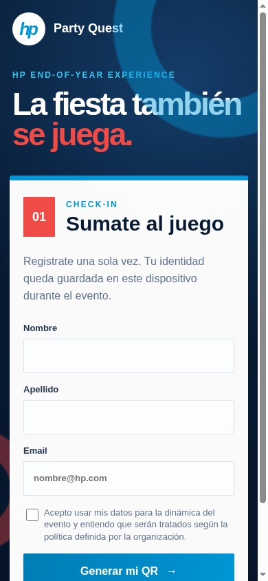

# HP Party Quest

MVP móvil para una fiesta de fin de año: registro, identidad persistente, QR personal, escaneo de candidatos y voto único.

La solución replica el modo operativo de la cartelera Work & Fun:

```text
GitHub repository
├── frontend/  ── GitHub Pages ── celulares y QR
└── backend/   ── clasp ───────── Google Apps Script
                                      │
                                      └── Google Sheet compartido
```

## Qué incluye

- Registro con nombre, apellido, email y consentimiento.
- Selfie obligatoria con consentimiento separado; puede agregarse o cambiarse desde el pase.
- Confirmación personalizada con nombre del votante y foto del candidato, visible solo para sesiones activas.
- El alta evita duplicar participantes. Por pedido del organizador, «Abrir mi pase» permite volver al registro existente con solo conocer su email; no comprueba acceso a la casilla.
- Sesión persistente en `localStorage`; en Sheets solo se guarda SHA-256.
- QR generado localmente en el navegador, sin CDN ni servicio de terceros.
- Link personal `?candidate=<QRToken>` sin nombre ni email.
- Vista de candidato y votación para el challenge activo.
- Un voto válido por participante y challenge.
- Bloqueo de auto-voto, voto duplicado, sesiones vencidas y challenges cerrados.
- `LockService` para evitar dobles inserciones concurrentes.
- Auditoría de altas, sesiones, votos aceptados y rechazos.
- Diseño responsive inspirado en la cartelera Work & Fun: azul marino, azul HP, acento rojo, Segoe UI y tarjetas modulares.

## Vista previa



## Estructura

```text
hp-party-quest/
├── .github/workflows/pages.yml
├── backend/
│   ├── Code.gs
│   ├── Data.gs
│   ├── Security.gs
│   ├── Setup.gs
│   ├── appsscript.json
│   └── .clasp.json.example
├── frontend/
│   ├── index.html
│   ├── config.js
│   ├── config.example.js
│   └── assets/
│       ├── app.js
│       ├── styles.css
│       └── vendor/hpq-qr.js
├── docs/
│   ├── ARCHITECTURE.md
│   ├── DEPLOY.md
│   └── TESTING.md
└── scripts/check-config.sh
```

## Base de datos

El backend ya apunta al Sheet compartido:

El identificador se guarda de forma privada en la propiedad de Apps Script `HPQ_SPREADSHEET_ID`. No se publica en GitHub.

El endpoint `health` ejecuta un bootstrap idempotente que valida y completa las hojas existentes sin borrar datos. También configura `FRONTEND_BASE_URL` y `APPS_SCRIPT_WEBAPP_URL` durante la publicación. Es compatible con las tablas nativas ya presentes en Google Sheets: conserva sus filtros propios y no intenta superponer un filtro de rango.

## Modo de operación

El proyecto se mantiene bajo el mismo esquema administrado de Work & Fun. Los cambios de código, validación, publicación y verificación se resuelven end-to-end sobre el repositorio y Apps Script; la persona organizadora no necesita editar archivos ni ejecutar secuencias locales de PowerShell.

## Publicación administrada (2.1.1)

El método habitual usa Git y la sesión local de Google Apps Script, igual que la cartelera. El backend se publica con la cuenta giwa-ia.com y su implementación conserva la misma URL en futuras actualizaciones. El proyecto de la cuenta HP no admite acceso anónimo por política del dominio.

El workflow `.github/workflows/pages.yml` publica solo el frontend y comprueba antes la salud del backend. No se transfieren credenciales de Google a GitHub. El pipeline original `release-live.yml` quedó exclusivamente manual; no se utiliza para la publicación habitual.

La especificación completa está en [`docs/DEPLOY.md`](docs/DEPLOY.md). Las pruebas funcionales del evento están en [`docs/TESTING.md`](docs/TESTING.md).

## Decisiones de seguridad y privacidad

- El QR contiene solo una URL con un token público aleatorio.
- El email nunca se devuelve al frontend después del registro ni aparece en el QR.
- El token de sesión real vive solamente en el dispositivo; Sheets guarda su hash.
- Las mutaciones usan `POST` con contenido `application/x-www-form-urlencoded`, evitando el preflight CORS que suele complicar Apps Script.
- El backend vuelve a validar sesión, challenge, candidato, auto-voto y duplicados; no confía en el navegador.
- No se guardan IP, geolocalización ni datos innecesarios.
- Las selfies se guardan en la misma base privada, sin crear enlaces de imágenes públicos. Ver [Selfies](docs/SELFIES.md).

## Alcance

El paquete queda listo para el flujo completo de registro → QR → escaneo → voto. Ranking público, consola de host y cierre de ganadores quedan como siguientes módulos; el esquema actual ya contiene `Dashboard`, `Winners` y las reglas necesarias para agregarlos sin cambiar la identidad del participante.

## Recuperar un pase existente

La opción «Abrir mi pase» usa solo el email registrado, sin códigos ni correos, y conserva el mismo QR, selfie y votos. Ver [regreso al pase](docs/RECOVERY.md).

## Resultados en la planilla

Dashboard se actualiza automáticamente con cada voto y registro, y al inicializar el servicio. Muestra la consigna activa, total de votos válidos y ranking. Votes conserva el detalle original. El organizador puede ejecutar refreshDashboard desde Apps Script para recalcular tras editar datos manualmente. Los empates comparten posición; este panel no confirma ganadores.

Dashboard incluye «Ver selfie» en cada fila del ranking. Winners dispone de SelfieURL para las filas de ganadores cargadas. El enlace abre una vista de la foto con descarga JPG; usa la sesión del juego y, si hace falta, el regreso simple por email. No declara ni confirma ganadores automáticamente.
